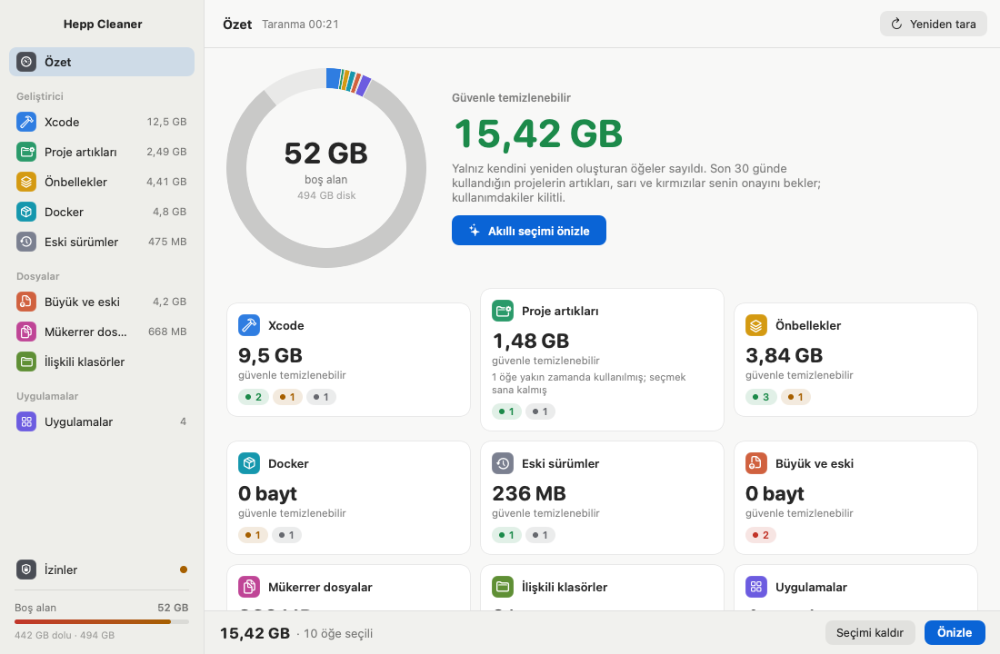
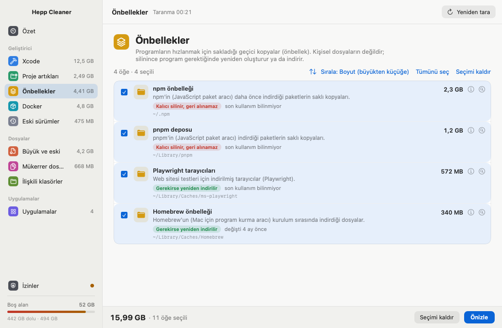
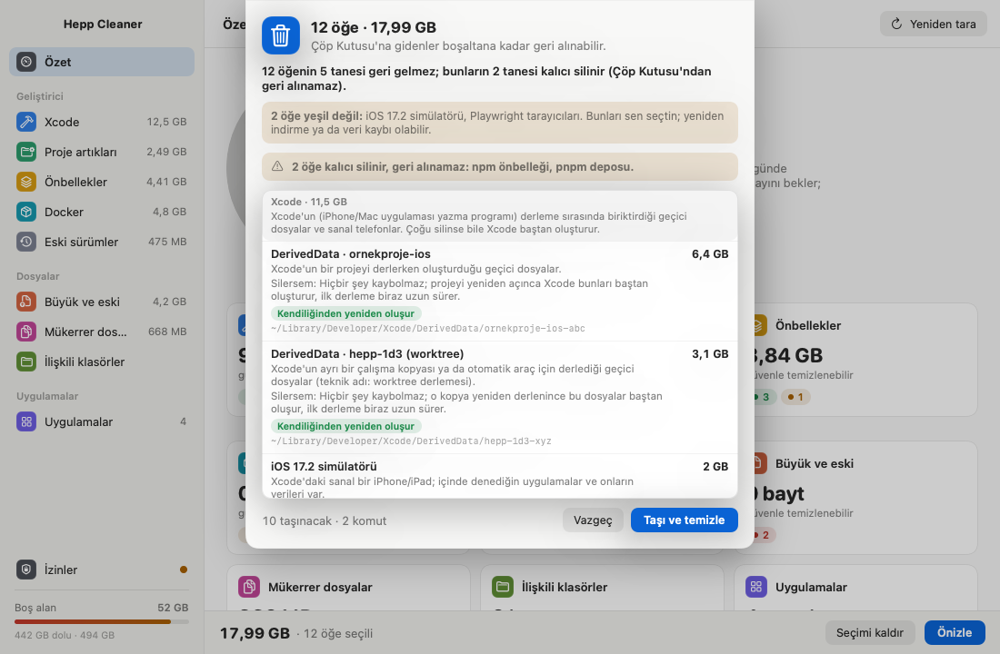
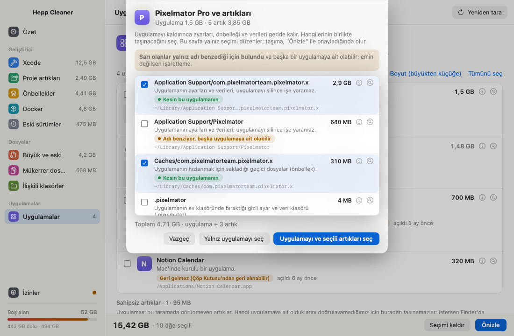
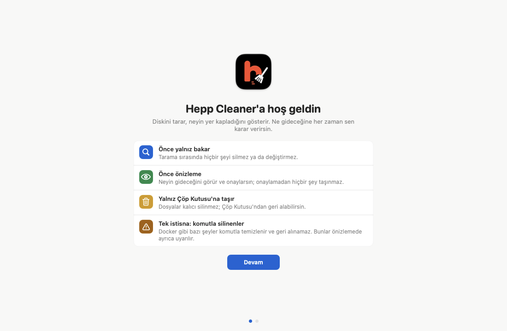

<p align="center">
  
</p>

<h1 align="center">Hepp Cleaner</h1>

<p align="center">
  Mac'inde neyin yer kapladığını gösteren, ne gideceğine senin karar verdiğin bir disk temizleyici.<br>
  Önce bakar, sonra önizler, yalnız Çöp Kutusu'na taşır.
</p>

<p align="center">
  <a href="https://github.com/aichera-ant/cleaner/releases/latest"><b>Son sürümü indir (DMG)</b></a>
  · macOS 14 Sonoma ve üstü · Apple Silicon
</p>



## Ne yapar?

Hepp Cleaner diskini tarar ve yer kaplayanları anlaşılır gruplara ayırır:

| Grup | Neler bulunur |
|---|---|
| **Xcode** | DerivedData, eski simülatörler, cihaz destek dosyaları, arşivler |
| **Proje artıkları** | `node_modules`, `.build`, `target`, `dist` gibi yeniden üretilebilen klasörler |
| **Önbellekler** | Uygulama, tarayıcı ve paket yöneticisi önbellekleri (npm, pnpm, Homebrew…) |
| **Docker** | Docker nesneleri; `docker` komutuyla temizlenir |
| **Eski sürümler** | Editör eklentilerinin, Node (fnm/nvm) ve geliştirici araçlarının eski sürümleri |
| **Büyük ve eski dosyalar** | Uzun süredir açılmamış büyük dosyalar |
| **Mükerrer dosyalar** | Birebir aynı içerikli kopyalar; son kopya hiçbir zaman seçilmez |
| **İlişkili klasörler** | Proje klasörlerindeki boş ya da yalnız `.DS_Store` içeren klasörler |
| **Uygulamalar** | Kurulu uygulamalar ve kaldırınca geride kalan ayar, önbellek ve veri klasörleri |

Her öğede sade bir açıklama vardır: *Bu ne?*, *Silersem ne olur?*, *Kendiliğinden geri gelir mi?*



## Güvenli olacak şekilde tasarlandı

- **Tarama hiçbir şeye dokunmaz.** Yalnız okur ve boyutları hesaplar.
- **Her zaman önce önizleme.** Neyin gideceğini görür, onaylarsın; onay olmadan hiçbir şey taşınmaz.
- **Yalnız Çöp Kutusu.** Dosyalar kalıcı silinmez; Çöp Kutusu'nu boşaltana kadar geri alınabilir.
- **Tek istisna açıkça yazılır.** `npm cache clean` gibi komutla temizlenen önbellekler geri alınamaz; önizlemede ayrıca uyarılır.
- **Renkli güven etiketleri.** Yeşil: kendiliğinden yeniden oluşur. Sarı: senin kararın. Kırmızı: dikkat, varsayılan olarak seçilmez.
- **Kilitler.** Çalışan uygulamalar, Hepp Cleaner'ın kendisi ve sistem klasörleri seçilemez. Son 30 günde kullandığın projelerin artıkları varsayılan seçime girmez.



## Uygulamaları artıklarıyla kaldır

Bir uygulamayı kaldırırken geride kalan ayar, önbellek ve veri klasörlerini de bulur. Kesin eşleşenler (paket kimliğiyle) yeşil, yalnız adı benzeyenler sarıdır ve kendiliğinden seçilmez. Komut satırı araçlarının ayar klasörleri (`~/.ssh`, `~/.config` gibi) hiçbir zaman artık sayılmaz.



## Menü çubuğu ve bildirimler

- Menü çubuğunda boş alan göstergesi ve kısa özet.
- Boş alan eşiğin altına düşünce, alan hızla azalınca ve haftalık temizlenebilir alan özeti için bildirim. Üçü de Ayarlar'dan ayrı ayrı kapatılabilir.
- Oturum açılışında başlar; Ayarlar'dan kapatılabilir.

## Kurulum

1. [Releases](https://github.com/aichera-ant/cleaner/releases/latest) sayfasından `Hepp-Cleaner-<sürüm>.dmg` dosyasını indir.
2. DMG'yi aç, **Hepp Cleaner**'ı **Uygulamalar** klasörüne sürükle.
3. İlk açılışta macOS uygulamanın doğrulanmadığını söyleyebilir (uygulama Apple'a notarize ettirilmedi). **Sistem Ayarları → Gizlilik ve Güvenlik** altında **Yine de Aç**'a bas. Bu yalnız bir kez gerekir.



### İzinler

İzinlerin hiçbiri zorunlu değildir; ilk açılışta tek sayfada gösterilir.

- **Tam Disk Erişimi:** `~/Library/Containers` gibi korunan klasörleri tarayıp temizleyebilmek için.
- **Bildirimler:** boş alan uyarıları için.
- **Finder otomasyonu:** korunan uygulamaları (ör. App Store uygulamaları) Finder üzerinden, parola/Touch ID onayıyla Çöp Kutusu'na taşımak için.

### Güncellemeler

Uygulama günde bir kez yeni sürüm olup olmadığına bakar ve kurmadan önce sorar. Elle: uygulama menüsünde ya da menü çubuğunda **Güncellemeleri denetle…**. Güncellemeler [Sparkle](https://sparkle-project.org) ile EdDSA imzalı olarak dağıtılır.

## Komut satırı

Aynı tarama motoru bir komut satırı aracı olarak da gelir:

```sh
swift run cleaner scan                  # temizlenebilir öğeleri listeler, hiçbir şeye dokunmaz
swift run cleaner trash <id>…           # varsayılan dry-run; gerçekten taşımak için --no-dry-run
```

## Kaynaktan derleme

Gereken: Xcode (Swift 6) ve [XcodeGen](https://github.com/yonaskolb/XcodeGen) (`brew install xcodegen`).

```sh
swift test                              # çekirdek ve arayüz mantığı testleri
SIGN_IDENTITY=- scripts/build-app.sh    # ad-hoc imzalı build/Hepp Cleaner.app
```

İmza, DMG ve sürüm çıkarma ayrıntıları: [docs/DAGITIM.md](docs/DAGITIM.md).

## Yapı

| Klasör | İçerik |
|---|---|
| `Sources/CleanerKit` | Tarama, kurallar, güvenlik politikası, Çöp Kutusu'na taşıma |
| `Sources/CleanerAppCore` | Arayüzden bağımsız görünüm modelleri, seçim, izleme, bildirim mantığı |
| `Sources/cleaner` | Komut satırı aracı |
| `App/` | SwiftUI uygulaması (XcodeGen projesi) |
| `scripts/` | Derleme, imza, DMG ve sürüm betikleri |
